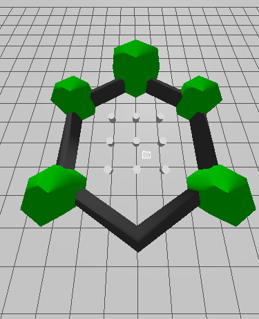

Updated upstream
# Lab 2 — Driving observations

- Official tutorial / ROS version:
- Model and world:
- Launch and teleoperation commands:
- Actual /cmd_vel message type:
- How did you stop and reset?
- What differed between a curve and an in-place turn?

Link the driving video and screenshot. Answer the four questions in the README.
=======
 Lab 2 Answers — TurtleBot Playground

## Driving observations
Describe what you observed during forward, reverse, curved, and in-place motion.

Forward: The robot moved in the direction it was heading
Reverse: The robot moved in the direction opposite to Forward
Curves: The robot moved in a circle
In-place: The robot rotates either clockwise or counter clockwise

## Challenge screenshot

## ROS signal preview

### Forward `/cmd_vel`

linear:
  x: 0.15
  y: 0.0
  z: 0.0
angular:
  x: 0.0
  y: 0.0
  z: 0.0

### Turning `/cmd_vel`
linear:
  x: 0.0
  y: 0.0
  z: 0.0
angular:
  x: 0.0
  y: 0.0
  z: 0.8

### `/odom` change

Before:
 position:
      x: 1.5961829889630008
      y: 0.17326242800385802
      z: 0.0
After:
 position:
      x: 1.7985006155500496
      y: -0.08554218550449713
      z: 0.0

The robot moved in the direction it was facing for 1 unit, causing the x position to increase and the y position to decrease
## Engineering questions

1. Forward: linear.x = 0.15     angular.z =0
Turning: Linear.x = 0    angular.z = 0.8
Stopping: Linear.x = 0   angular.z = 0
The keyboard node and the direct terminal command were able to publish the same command because they both share the same /cmd_vel topic.

2. Only the x,y postions and z,w orientations changed and it's an estimate because it calculates these values by adding onto previous values rather than measuring them.

3. Because this command needs feedback to know when it has reached its goal.

4. I sensed the robot's position and the surrounding obstacles. I decided how to traverse the obstacles. I excecuted the movement commands by pressing the keyboard.
>>>>>>> Stashed changes
