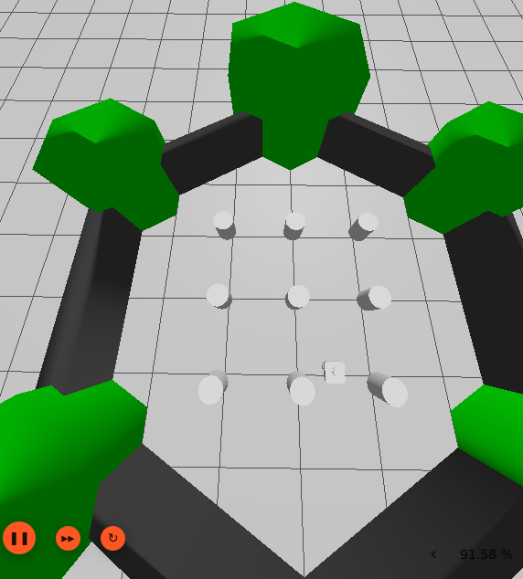
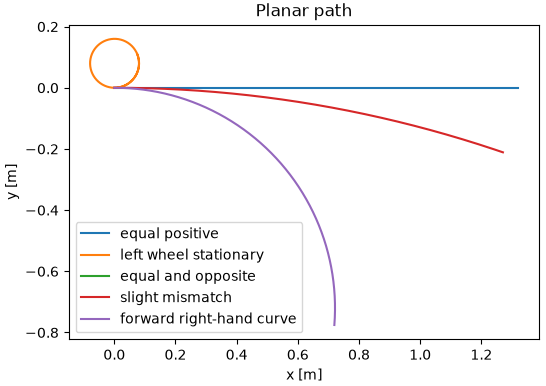
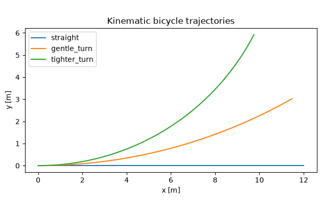
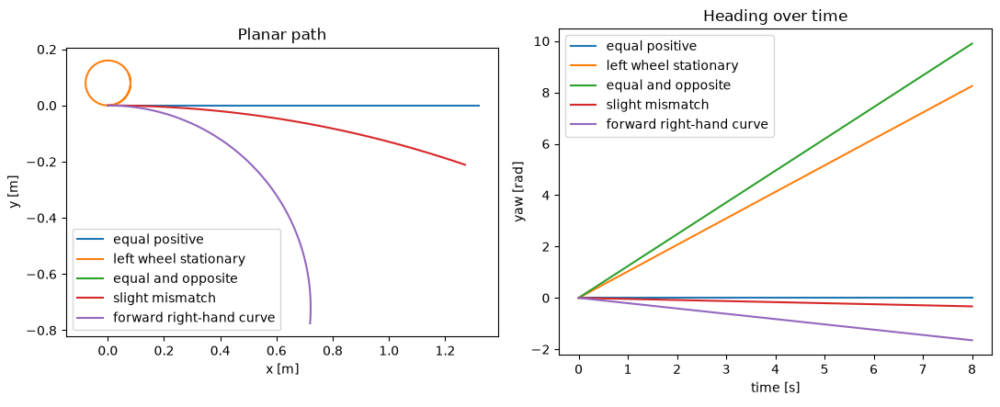

# Lab 3 Answers

## Part 1 predictions

1. v = +   θ̇ = 0    The vehicle will move forward with no yaw
2. v = +   θ̇ = +    The vehicle will move in a curved motion counter clockwise
3. v = 0   θ̇ = +    The vehicle will rotate counter clockwise in place
4. v = +   θ̇ = -    The vehicle will move in a curved motion clockwise
## Differential-drive validation

case                            x [m]        y [m]    yaw [rad]

equal positive                 1.3200       0.00       0.00    The vehicle only went forward with no change in yaw
left wheel stationary          0.0749       0.11       8.25    The vehicle went to forward and to the left similar to moving counter clockwise
equal and opposite             0.0000       0.00       9.90    The vehicle rotated in place counter clockwise
slight mismatch                1.2703      -0.21      -0.33    The vehicle went forward and to the right similar to moving clockwise
## Student motion-design challenge

Predicted wheel-speed relationship or calculation: forward right-hand curve
Chosen $\omega_L$ [rad/s]: 5
Chosen $\omega_R$ [rad/s]: 4
Final $(x,y,\theta)$: (0.7193, -0.7755, -1.6500)
Target met?: Yes
## TurtleBot visual checkpoint
Straight Motion

Before
x: 0.774900223731602
y: 2.3024688295597263e-09

After
x: 1.2501002237378724
y: 3.714722537606437e-09
This change is similar because it changes based on increments.

## Bicycle-model observations

case                wheel [rad/s]   steer [rad]   speed [m/s]  yaw rate [rad/s]

straight                    5.000         0.000         1.500             0.000    Zero steering causes the vehicle to move straight forward with no yaw
gentle_turn                 5.000         0.120         1.500             0.065    
tighter_turn                5.000         0.250         1.500             0.137    Increasing steering maginitude leads to a higher yaw rate
## Model comparison

Ideal differentation drive takes inputs of left wheel speed and right wheel speed and that allows it to rotate in place and move in both straight and curved motion; however, this can't be used in vehicles whose wheel speed isn't independent of eachother. The kinematic bicycle model takes inputs of wheel speed and steering angle, but that prevents it from being able to rotate in place and rotate with a small turning radius.

## Engineering questions

1.  Integrating wheel-derived velocity is called dead reckoning because there are slight value changes caused by rounding during every step of integration. This causes error to build up over each integration until it reaches a point where it's significant.
2. 
Equal: Straight motion
Different wheel speed: Curved
Equal and Opposite: In place motion
3. Because every calculation is added onto the last value, a small mismatch can cause the vehicle to add an incorrect value every time it calculates the movement. 
4. It isn't a ground truth because it calculates by adding sensed values onto current values to calculate the position. This method is susceptible to dead reckoning and can cause errors in the value.
5. Because the wheels can't move independently, there is no way to cause the equal and opposite forces to cause a moment. Instead it depends on the wheels themselves turning which causes the bicycle model to have a turning radius. 
6. According to the formula: R= L/tan(δ)
A wider wheelbase would cause a larger turning radius.
A steering angle closer to 90 degrees would cause a smaller turning radius.

